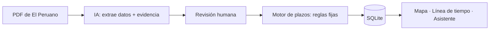

# Plazos tarifarios 💧

> Completa todo lo que está entre [corchetes] antes de entregar. No inventes cifras: usa las de tus 3 conversaciones.

## 1. One-liner

Controlamos los plazos legales de los procedimientos tarifarios para las gerencias de regulación, leyendo las resoluciones de El Peruano con IA y calculando los días hábiles automáticamente.

## 2. Founder

**[Tu nombre]** · [foto: `docs/capturas/founder.jpg`]

Trabajo en una gerencia que elabora los estudios tarifarios de [N] empresas prestadoras de saneamiento. Controlo estos plazos todos los días: sé dónde se complica (ampliaciones, feriados, etapas que se cruzan) y qué información pide un gerente cuando la necesita de inmediato.

Cubro producto, ingeniería, diseño y ventas. La IA (Claude) me ayudó a programar; las reglas del negocio y la validación son mías.

## 3. Problema

**Quién lo sufre:** los analistas y el gerente de una gerencia de regulación tarifaria que lleva en paralelo los procedimientos de revisión periódica de [N] EPS.

**Cuánto le cuesta:**
- Cada procedimiento tiene 7 etapas con plazos en días hábiles: [N × 7] plazos al año.
- Cada resolución nueva se lee y se transcribe a mano, y los días hábiles se cuentan con feriados y ampliaciones: [X horas por resolución, según las conversaciones].
- Responder «¿en qué etapa va tal EPS?» toma [X minutos u horas] porque la información está repartida en PDF, correos y Excel.
- Si un plazo legal se pasa, hay consecuencias [describe cuáles].

**Cómo lo resuelven hoy:** Excel, calendarios personales, correos y memoria.

**Evidencia:** notas de 3 conversaciones con usuarios potenciales en [`docs/research/`](docs/research/).

## 4. Solución e insight

Una app donde subes la resolución publicada en El Peruano y:
1. La **IA lee el PDF o el enlace de la norma en El Peruano** y extrae la EPS, el número, la fecha de emisión y la fecha de publicación, mostrando la cita y la página de donde sacó cada dato.
2. Una persona **revisa y confirma**.
3. Un **motor de reglas** calcula el cronograma completo en días hábiles, con feriados y ampliaciones.
4. Con la **resolución que aprueba el estudio tarifario**, la IA extrae el periodo regulatorio y el motor calcula sus hitos legales: según los artículos del Reglamento General de Tarifas, se debe comunicar a la EPS el siguiente periodo como máximo **19 meses antes del término**, y la EPS presenta su solicitud a más tardar **10 meses antes**. El inicio del periodo se calcula con la regla que corresponda: primer día del mes siguiente a la publicación (regla anterior) o primer día del año fiscal siguiente (regla actual).
5. Todo aparece en un **mapa en semáforo**, una **línea de tiempo** y un **asistente** al que se le pregunta «¿qué vence esta semana?» o «¿cuáles son los plazos de esta EPS?».

**Insight:** las herramientas genéricas (Excel, Planner, Google Calendar) no leen resoluciones ni cuentan días hábiles según un reglamento. Y la IA sola tampoco sirve para esto, porque un plazo legal no puede depender de lo que adivine un modelo. La combinación correcta es: **la IA lee, las reglas calculan y una persona confirma**.

## 5. Why now

- Los modelos de lenguaje ya leen documentos legales en español con buena precisión y a bajo costo, incluso PDF escaneados.
- Los agentes con herramientas permiten conversar con datos verificados sin que el modelo invente fechas.
- Hace tres años esto habría requerido entrenar un modelo propio para cada tipo de resolución.

## 6. Demo

**URL pública:** [https://TU-APP.streamlit.app](https://TU-APP.streamlit.app)
**Video de respaldo (60–90 s):** [enlace]

Cómo correrlo en tu laptop:
```bash
pip install -r requirements.txt
cp .env.example .env      # pega una clave de Gemini o de Claude
streamlit run app/app.py
```
Sin clave, la app funciona en modo básico (lectura con expresiones regulares y asistente limitado).

| Tablero | Lectura de la resolución | Asistente |
|---|---|---|
|  |  |  |

**Arquitectura** (detalle en [`docs/arquitectura.md`](docs/arquitectura.md)):



**Modelos:** `claude-haiku-5-5` o `gemini-2.5-flash` (configurable). Usamos un modelo rápido y barato porque las resoluciones son cortas y la tarea es estructurada; Gemini tiene capa gratuita, útil para el piloto. Las resoluciones son públicas, así que no hay problema de confidencialidad al enviarlas a una API.

## 7. Modelo de negocio

**Quién paga:** la entidad (la gerencia o el regulador), no cada analista.

| Plan | Para quién | Precio (hipótesis por validar) |
|---|---|---|
| Piloto | Un equipo, hasta 10 procedimientos | Gratis por 3 meses |
| Equipo | Una gerencia, hasta 60 procedimientos, asistente y alertas | S/ [900] al mes |
| Institucional | Varias gerencias o entidades, lectura automática de El Peruano | S/ [3,500] al mes |

**Costo por cliente (estimado):**
- Leer una resolución: unos 5,000 tokens de entrada y 500 de salida.
- Una pregunta al asistente: unos 10,000 tokens (2 o 3 rondas con herramientas).
- Un equipo típico al mes: 60 resoluciones y 300 preguntas ≈ 3.3 millones de tokens.
- Costo en IA = tokens × precio vigente del modelo ([ver precios del proveedor]). Servidor: S/ 0 en el piloto (Streamlit Community Cloud).
- **Margen de contribución:** [precio del plan − costo de IA − servidor].

## 8. Herramientas del curso

| Herramienta | Dónde está en el repo |
|---|---|
| **Document AI con salidas estructuradas** | `ai/extraer_resolucion.py`, `ai/prompts/extraccion.md` |
| **Agentes** (con herramientas) | `ai/asistente.py`, `ai/llm.py` (función `conversar`) |
| **Scraping** de El Peruano (pegar el enlace de la norma) | `ai/extraer_resolucion.py` (funciones `extraer_url` y `html_a_texto`) |
| **Mapas** | `app/app.py` (función `mapa`), `data/geo/peru_departamentos.geojson` |
| **Sitio web** | `app/app.py`, publicado en Streamlit Community Cloud |

Claude Code y Claude se usaron para programar; no cuentan como herramienta del producto.

## 9. Qué hizo el agente

[Revisa y ajusta esta sección con honestidad.]

- **Generado con Claude:** la primera versión del código (`app/`, `ai/`, `backend/`), las pruebas (`tests/`), los datos de demostración sintéticos y el borrador de este README y de `docs/`.
- **Hecho por mí:** la definición del problema, las etapas y plazos del procedimiento (`data/reglas/etapas.yaml`), la revisión de cada archivo, las pruebas con resoluciones reales, las 3 conversaciones con usuarios y [lo que agregues].
- Entiendo y puedo explicar cada parte del código. Las decisiones clave están en `docs/arquitectura.md`.

---

### Opcional: para postular a una aceleradora

- **Mercado:** [TAM, SAM y SOM con fuentes: entidades públicas del Perú con procedimientos sujetos a plazos legales; reguladores de Latinoamérica].
- **Competencia:** no hacer nada, Excel y calendarios, gestores de proyectos genéricos (Planner, Asana), sistemas de trámite documentario del Estado. Ninguno lee resoluciones ni calcula plazos según el reglamento.
- **Primeros usuarios:** 10 = mi gerencia y gerencias vecinas; 100 = otros reguladores y EPS; 1,000 = municipalidades y estudios de abogados.
- **Plan:** 3 meses, piloto en mi gerencia con resoluciones reales; 6 meses, lectura automática de El Peruano y alertas; 12 meses, segundo regulador.
- **Riesgos:** adopción en el sector público, exactitud de la extracción, cambios en los reglamentos.

### Licencia

MIT. Ver [LICENSE](LICENSE).
