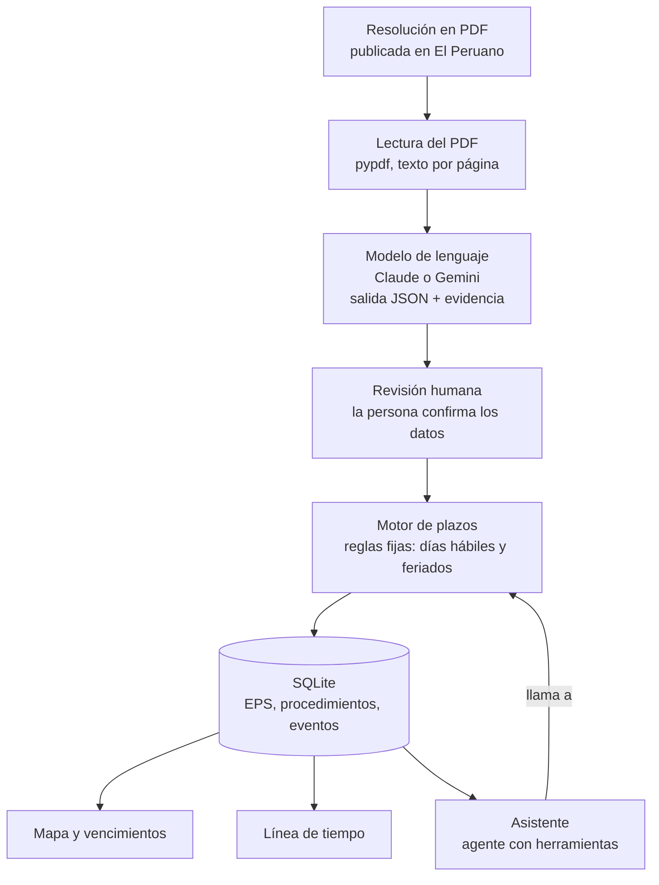

# Arquitectura

## Decisiones de diseño

**La IA lee, las reglas calculan.** El modelo de lenguaje solo extrae datos del documento (EPS, número, fechas, días de ampliación). Las fechas límite las calcula `backend/plazos.py` con reglas fijas y el calendario de feriados. Un plazo legal no puede depender de lo que "adivine" un modelo, y así cada fecha se puede verificar a mano.

**Siempre hay revisión humana.** La extracción se muestra con su evidencia (cita literal y página) y la persona confirma antes de guardar.

**El asistente no inventa fechas.** Es un agente con herramientas (`ai/asistente.py`): busca la EPS, consulta el motor de plazos y redacta la respuesta con lo que devuelve.

## Modelos y por qué

| Uso | Modelo por defecto | Motivo |
|---|---|---|
| Extracción de resoluciones | `claude-haiku-5-5` o `gemini-2.5-flash` | Documentos cortos y tarea estructurada: un modelo rápido y barato basta. Gemini tiene capa gratuita. |
| Asistente | El mismo | Respuestas breves con uso de herramientas. |

Se cambia con `LLM_PROVIDER` y `LLM_MODEL` en `.env`. Las resoluciones son públicas, así que no hay problema de confidencialidad al enviarlas a una API.

## Archivos clave

| Archivo | Qué hace |
|---|---|
| `app/app.py` | Interfaz en Streamlit: tablero, línea de tiempo, registro de resoluciones, asistente y equipo |
| `ai/extraer_resolucion.py` | PDF → texto → JSON validado → EPS del catálogo |
| `ai/prompts/extraccion.md` | Instrucciones de extracción |
| `ai/asistente.py` | Agente con herramientas sobre el motor de plazos |
| `ai/llm.py` | Capa común para Claude y Gemini |
| `backend/plazos.py` | Motor de plazos en días hábiles |
| `backend/periodos.py` | Periodo regulatorio: inicio, término e hitos de 19 y 10 meses |
| `backend/datos.py` | Base de datos SQLite |
| `backend/cli.py` | Los mismos cálculos desde la terminal (`python -m backend ...`) |
| `backend/ics.py` | Exporta vencimientos e hitos a un calendario `.ics` (RFC 5545) |
| `data/reglas/` | Etapas, plazos, feriados y reglas del periodo regulatorio (editables sin tocar código) |
| `tests/` | Pruebas del motor, la extracción y el agente |

## Decisiones sobre los datos

**Los feriados se cargan por año y el motor avisa cuando le faltan.** `data/reglas/feriados.csv`
tiene los 16 feriados nacionales de 2023 a 2028, con Jueves y Viernes Santo calculados por el
Computus gregoriano (una prueba verifica que las fechas del archivo coincidan). Un año sin filas
es indistinguible de un año sin feriados: por eso `plazos.advertencias_calendario()` devuelve un
aviso que la app y la CLI muestran, en lugar de entregar una fecha que parece legal y no lo es.

**Los eventos que el motor no entiende se reportan, no se descartan.** Una ampliación que nombra
una etapa inexistente o con cero días no puede aplicarse: `plazos.eventos_aplicables()` la separa
y `Estado.advertencias` la nombra, para que el plazo no salga más corto que el que concedió la
resolución.

**El periodo se da por solicitado si la EPS presentó su procedimiento.** `datos.tablero()` marca
la solicitud con cualquier procedimiento publicado dentro del periodo, esté en curso o concluido:
antes, al cerrar la última etapa el periodo volvía a «Solicitud no registrada» y el tablero
acusaba a la EPS de no haber presentado nada.
